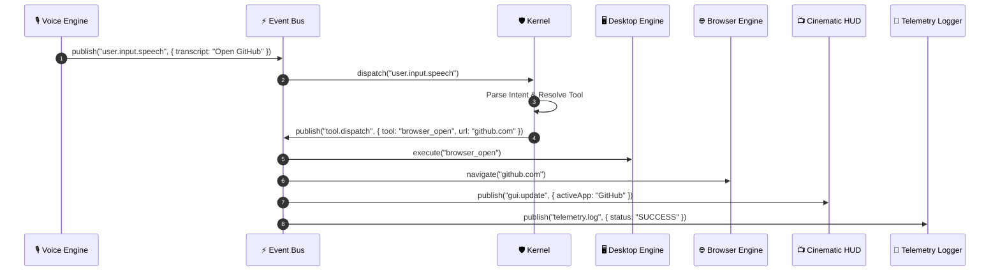
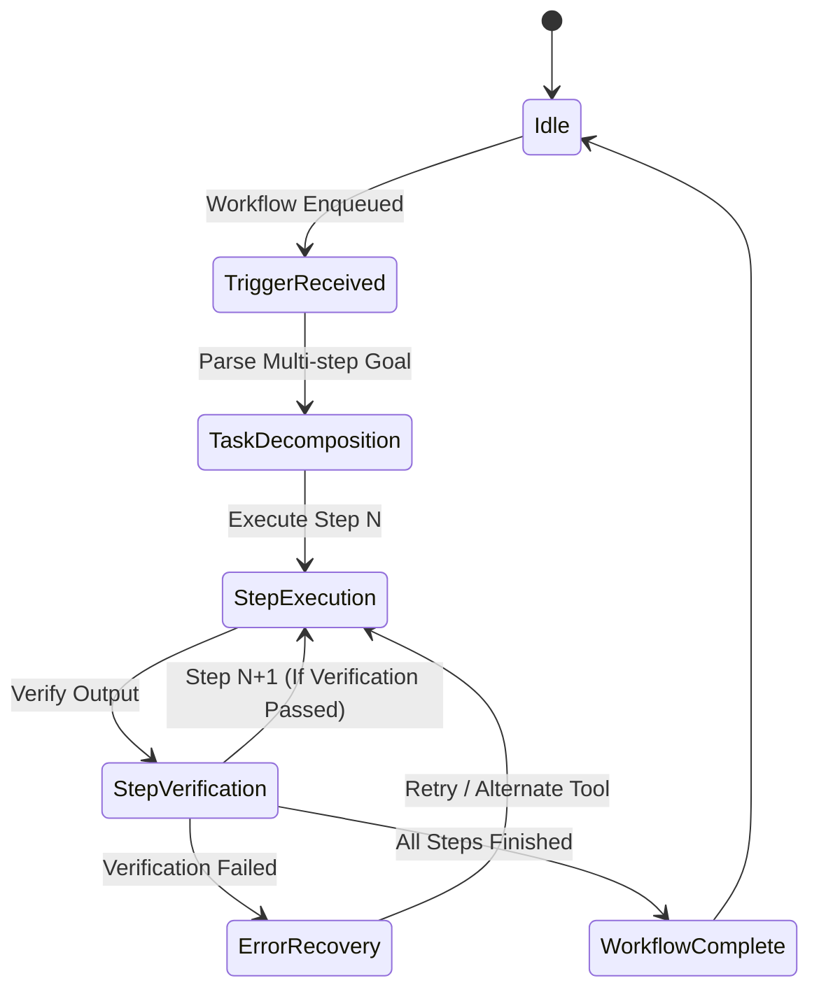
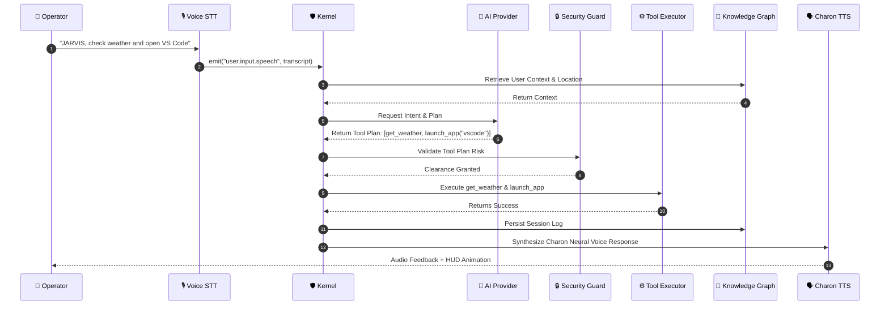

# JARVIS AI Operating System
## Official Master System Architecture Blueprint & Engineering Specification
**Document Version:** 4.2.0-STARK  
**Classification:** Core System Architecture Specification  
**Visual Documentation:** Includes SVG vector topology, ASCII schema, and Mermaid interaction diagrams.

---

## Table of Contents
1. [High-Level System Architecture](#1-high-level-system-architecture)
2. [Kernel Architecture & Principles](#2-kernel-architecture--principles)
3. [Continuous Runtime Engine Architecture](#3-continuous-runtime-engine-architecture)
4. [High-Speed Asynchronous Event Bus Architecture](#4-high-speed-asynchronous-event-bus-architecture)
5. [AI Provider Manager & Model Routing Topology](#5-ai-provider-manager--model-routing-topology)
6. [Multi-Agent Swarm Architecture](#6-multi-agent-swarm-architecture)
7. [Semantic Memory & Knowledge Graph Architecture](#7-semantic-memory--knowledge-graph-architecture)
8. [Tool Execution Pipeline & Hardware Interface](#8-tool-execution-pipeline--hardware-interface)
9. [Desktop & OS Control Pipeline](#9-desktop--os-control-pipeline)
10. [Autonomous Workflow Engine](#10-autonomous-workflow-engine)
11. [Plugin & Extension Architecture](#11-plugin--extension-architecture)
12. [Security, Risk Guard & Authority Architecture](#12-security-risk-guard--authority-architecture)
13. [End-to-End Request Lifecycle](#13-end-to-end-request-lifecycle)
14. [Complete Recommended Folder Architecture](#14-complete-recommended-folder-architecture)
15. [Global Data Flow & Event Propagation](#15-global-data-flow--event-propagation)
16. [Comprehensive Component Breakdown](#16-comprehensive-component-breakdown)

---

## 1. High-Level System Architecture

The **JARVIS AI Operating System** is designed as an autonomous, event-driven, full-stack AI substrate. Rather than operating as a simple conversational chatbot or ephemeral assistant, JARVIS functions as a persistent operating system layer that bridges natural user intent (Voice, Vision, GUI, CLI) directly to operating system primitives, cloud services, and multi-agent reasoning networks.

### High-Level Topology ASCII Diagram

```
+---------------------------------------------------------------------------------------------------+
|                                  USER INTERFACE & INGRESS LAYER                                   |
|  +------------------+  +-------------------+  +-------------------+  +------------------------+  |
|  | Neural Speech    |  | Cinematic HUD     |  | JARVIS System     |  | Optic Camera Vision    |  |
|  | STT Ingress      |  | (Voice Mode UI)   |  | Console           |  | & Screen OCR Inspector |  |
|  +--------+---------+  +---------+---------+  +---------+---------+  +-----------+------------+  |
+-----------|----------------------|----------------------|------------------------|----------------+
            |                      |                      |                        |
            +----------------------+----------+-----------+------------------------+
                                              |
                                              v
+---------------------------------------------------------------------------------------------------+
|                        HIGH-SPEED SYSTEM EVENT BUS (ASYNCHRONOUS EVENT ROUTER)                      |
|                  Events: user.input, vision.frame, system.telemetry, tool.execute                 |
+---------------------------------------------+-----------------------------------------------------+
                                              |
                                              v
+---------------------------------------------------------------------------------------------------+
|                                   JARVIS KERNEL & RUNTIME ENGINE                                  |
|  +--------------------+  +--------------------+  +--------------------+  +---------------------+  |
|  | Heartbeat Monitor  |  | Priority Task      |  | Security & Risk    |  | GUI Autonomy        |  |
|  | & 24/7 Tick        |  | Scheduler          |  | Guard Authority    |  | Governor            |  |
|  +--------------------+  +--------------------+  +--------------------+  +---------------------+  |
|  +--------------------+  +--------------------+  +--------------------+  +---------------------+  |
|  | Intent Router &    |  | Tool Execution     |  | Autonomous         |  | Charon TTS Voice    |  |
|  | Reasoning Core     |  | Engine             |  | Workflow Engine    |  | Synthesizer         |  |
|  +--------------------+  +--------------------+  +--------------------+  +---------------------+  |
+-------------------+---------------------+---------------------+-------------------+---------------+
                    |                     |                     |                   |
        +-----------+         +-----------+         +-----------+       +-----------+
        |                     |                     |                   |
        v                     v                     v                   v
+---------------+     +---------------+     +---------------+   +-----------------------+
|  AI PROVIDER  |     |  MULTI-AGENT  |     |   KNOWLEDGE   |   |  DESKTOP & OS ENGINE  |
|    ROUTER     |     |     SWARM     |     |  GRAPH MEMORY |   | (Python Bridge, CLI)  |
| (Gemini/Local)|     | (Code/Debug)  |     | (Vector Store)|   |                       |
+---------------+     +---------------+     +---------------+   +-----------------------+
        |                     |                     |                   |
        +---------------------+----------+----------+-------------------+
                                         |
                                         v
+---------------------------------------------------------------------------------------------------+
|                        EXTENSIONS, PLUGINS & EXTERNAL INTEGRATION LAYER                            |
|    +-------------------+   +------------------+   +------------------+   +-------------------+    |
|    | VS Code Plugin    |   | Telegram Bot     |   | Discord Plugin   |   | Android App Sync  |    |
|    +-------------------+   +------------------+   +------------------+   +-------------------+    |
+---------------------------------------------------------------------------------------------------+
```

### Visual Diagram Artifact
An interactive, high-resolution vector version of this diagram is compiled at:  
`docs/architecture/system_overview.svg`

---

## 2. Kernel Architecture & Principles

The **JARVIS Kernel** is the centralized microkernel coordinator of the operating system. No subsystem is allowed to directly invoke or mutate another subsystem's state. All communication must pass through the Kernel or register through the Event Bus.

### Kernel Decoupling Architecture

```
                       +-------------------------+
                       |    JARVIS KERNEL        |
                       |  (Central Microkernel)  |
                       +------------+------------+
                                    |
     +-----------------+------------+------------+-----------------+
     |                 |                         |                 |
     v                 v                         v                 v
+----------+   +---------------+        +------------------+  +----------+
| Event    |   | AI Provider   |        | Knowledge Graph  |  | OS       |
| Bus      |   | Manager       |        | Memory Vault     |  | Bridge   |
+----------+   +---------------+        +------------------+  +----------+
```

### Why Microkernel Architecture is Mandatory:
1. **Fault Isolation:** If an external AI provider fails or a third-party plugin crashes, the Kernel's supervisor process isolates the fault and prevents system-wide panic.
2. **Deterministic Security:** Every request passes through the Security & Risk Guard within the Kernel before tool execution. Direct component-to-component calls would bypass privilege checks.
3. **Hot-swappability:** Individual engines (e.g., switching from Gemini to a local Ollama model) can be hot-reloaded at runtime without restarting the main loop.
4. **Unified Auditing:** All inputs, execution traces, and outputs are logged deterministically by the Kernel Telemetry service.

---

## 3. Continuous Runtime Engine Architecture

The **Continuous Runtime Engine** powers JARVIS's 24/7 background operation. It ensures the OS remains responsive to voice, background timers, system metrics, and autonomous token guards even when no user input is actively occurring.

### Runtime Subsystems ASCII Blueprint

```
+---------------------------------------------------------------------------------+
|                           CONTINUOUS RUNTIME ENGINE                             |
+---------------------------------------------------------------------------------+
|  +--------------------+   +--------------------+   +-------------------------+  |
|  | Heartbeat Loop     |   | Task Scheduler     |   | Event Queue             |  |
|  | (100ms Tick)       |   | (Cron & Timers)    |   | (Priority FIFO)         |  |
|  +--------------------+   +--------------------+   +-------------------------+  |
|  +--------------------+   +--------------------+   +-------------------------+  |
|  | Structured Logger  |   | Telemetry Engine   |   | Fault Recovery Manager  |  |
|  | (Console/File)     |   | (CPU/RAM/FPS)      |   | (Self-healing Guard)    |  |
|  +--------------------+   +--------------------+   +-------------------------+  |
|  +--------------------+   +--------------------+   +-------------------------+  |
|  | Plugin Loader      |   | Notification Mgr   |   | Autonomous Token Guard  |  |
|  | (Hot-swapping)     |   | (OS Toasts)        |   | (Sleep / Idle Guard)    |  |
|  +--------------------+   +--------------------+   +-------------------------+  |
+---------------------------------------------------------------------------------+
```

### Subsystem Function Matrix

| Runtime Subsystem | Responsibilities | Default Interval / SLA |
| :--- | :--- | :--- |
| **Heartbeat Loop** | System pulse, state verification, liveness checks | 100ms per tick |
| **Task Scheduler** | Scheduled cron tasks, one-shot background timers | Dynamic (1s to 24h) |
| **Event Queue** | Asynchronous message passing, priority routing | High-priority (<5ms) |
| **Telemetry Engine** | Monitored RAM, CPU utilization, WebGL FPS, Latency | 1000ms |
| **Fault Recovery** | Auto-restarting crashed modules, resetting stale sockets | Event-driven on error |
| **Autonomous Token Guard** | Detects operator sleep/absence, pauses camera/OCR vision | 120s idle threshold |

---

## 4. High-Speed Asynchronous Event Bus Architecture

The **Event Bus** is the central nervous system of JARVIS. It implements a non-blocking publish-subscribe pattern allowing decoupled components to publish system events and subscribe to specific topics.

### Mermaid Event Propagation Flow



---

## 5. AI Provider Manager & Model Routing Topology

JARVIS features a multi-LLM router that automatically selects the optimal AI model based on task complexity, latency requirements, privacy constraints, and token efficiency.

### AI Routing Architecture ASCII Tree

```
AI Provider Manager
├── Gemini Router (Default Cloud Provider)
│   ├── Gemini 3.6 Flash  --> High-speed conversational & multimodal tasks (<300ms)
│   └── Gemini 3.5 Pro    --> Complex reasoning, architectural coding, long-context
├── NVIDIA Nemotron Ultra --> Ultra-fast structured code generation & function calling
├── OpenAI Router
│   ├── GPT-4o            --> Multimodal verification & fallback
│   └── O1 / O3 Mini      --> Complex mathematical & symbolic logic
├── Anthropic Claude      --> Detailed technical writing & refactoring
└── Local Ollama / DeepSeek
    ├── DeepSeek R1       --> Offline private reasoning & code generation
    └── Llama 3 8B Local  --> Zero-latency offline task fallback
```

### Automatic Model Selection Rules:
* **Voice Interactions (<400ms target):** Routed to **Gemini 3.6 Flash** or **Local Llama**.
* **Complex Multi-File Coding:** Routed to **Gemini 3.5 Pro** or **Claude 3.5 Sonnet**.
* **Offline / Air-Gapped Mode:** Automatically fails over to **Local DeepSeek R1 / Ollama**.

---

## 6. Multi-Agent Swarm Architecture

For complex user directives, the **Master Agent** spawns and coordinates specialized micro-agents in parallel.

### Multi-Agent Swarm Diagram

```
                             +-----------------------+
                             |     MASTER AGENT      |
                             | (Task Orchestration)  |
                             +-----------+-----------+
                                         |
    +-----------------+------------------+------------------+-----------------+
    |                 |                  |                  |                 |
    v                 v                  v                  v                 v
+-------+        +----------+       +----------+       +----------+      +----------+
| Code  |        | Research |       | Debug    |       | Browser  |      | UI/GUI   |
| Agent |        | Agent    |       | Agent    |       | Agent    |      | Agent    |
+-------+        +----------+       +----------+       +----------+      +----------+
```

### Visual Diagram Artifact
Compiles at: `docs/architecture/multi_agent_flow.svg`

---

## 7. Semantic Memory & Knowledge Graph Architecture

JARVIS maintains persistent context across sessions using a hybrid memory model combining **Short-Term Context**, **Vector Semantic Storage**, and an **Entity Knowledge Graph**.

### Memory Hierarchy Blueprint

```
User Query / Sensor Input
          │
          v
+------------------------------------------------------------------+
|                    WORKING MEMORY BUFFER                         |
| (Active Chat History, Recent Vision Frames, System Telemetry)   |
+---------------------------------+--------------------------------+
                                  │
                  +---------------+---------------+
                  │                               │
                  v                               v
+-----------------------------------+   +------------------------------------+
|   LONG-TERM VECTOR STORE          |   |      ENTITY KNOWLEDGE GRAPH        |
| (Semantic Embeddings, Searchable  |   | (Nodes: User, Projects, Preferences|
| Memory Vault, Historical Logs)    |   | Relationships: owns, prefers, targets)
+-----------------------------------+   +------------------------------------+
```

---

## 8. Tool Execution Pipeline & Hardware Interface

The Tool Execution Pipeline provides a safe, monitored sandbox for executing shell commands, file modifications, and web requests.

```
User Request ──> Speech STT ──> Kernel ──> AI Reasoning ──> Security Authority ──> Tool Executor ──> OS / Hardware
```

---

## 9. Desktop & OS Control Pipeline

JARVIS interacts directly with the host environment using a native **Python OS Bridge** and API drivers.

```
+--------------------------------------------------------------------------+
|                          DESKTOP CONTROL ENGINE                          |
|  +--------------------+  +--------------------+  +--------------------+  |
|  | Python OS Bridge   |  | Mouse & Keyboard   |  | Application        |  |
|  | Native Subprocess  |  | Event Synthesizer  |  | Launcher & Focus   |  |
|  +--------------------+  +--------------------+  +--------------------+  |
|  +--------------------+  +--------------------+  +--------------------+  |
|  | Filesystem Engine  |  | Playwright Browser |  | System Audio       |  |
|  | File I/O & Search  |  | Automation Engine  |  | Synthesizer & Mixer|  |
|  +--------------------+  +--------------------+  +--------------------+  |
+--------------------------------------------------------------------------+
```

---

## 10. Autonomous Workflow Engine

The **Workflow Engine** enables multi-step task execution without human intervention.



---

## 11. Plugin & Extension Architecture

The **Plugin Manager** exposes hot-swappable extension hooks allowing external software to integrate with JARVIS.

```
                   +------------------------+
                   |  JARVIS PLUGIN ENGINE  |
                   +-----------+------------+
                               |
     +------------+------------+------------+------------+
     |            |                         |            |
     v            v                         v            v
+----------+ +----------+              +----------+ +----------+
| VS Code  | | Telegram |              | Discord  | | Android  |
| Plugin   | | Bot      |              | Plugin   | | App Sync |
+----------+ +----------+              +----------+ +----------+
```

---

## 12. Security, Risk Guard & Authority Architecture

Security is enforced at the Kernel boundary. Every tool action is evaluated against a dynamic risk matrix before authorization.

```
[Tool Command Request] ──> [Authority Engine] ──> Risk Score Check
                                                     │
                                 +-------------------+-------------------+
                                 │                                       │
                        Risk < Threshold                        Risk >= Threshold
                                 │                                       │
                                 v                                       v
                      [AUTO-CLEAR & EXECUTE]                 [PROMPT USER FOR CONFIRMATION]
```

---

## 13. End-to-End Request Lifecycle

The complete flow from voice wake-word to physical response:



### Visual Diagram Artifact
Compiles at: `docs/architecture/request_lifecycle.svg`

---

## 14. Complete Recommended Folder Architecture

Below is the definitive project structure for the entire JARVIS AI Operating System:

```
jarvis-ai-os/
├── .env.example                     # Environment Variable Template
├── package.json                     # Node.js Project Manifest
├── tsconfig.json                    # TypeScript Configuration
├── vite.config.ts                   # Vite + Tailwind Build Config
├── App.tsx                          # Primary React UI Root Component
├── main.py                          # Python Native OS Bridge Entry Point
├── index.html                       # Application HTML Container
├── types.ts                         # Global TypeScript Type Declarations
│
├── core/                            # Kernel & Core Subsystems
│   ├── Kernel.ts                    # Central Microkernel Manager
│   ├── EventBus.ts                  # High-Speed Event Bus Implementation
│   ├── SecurityAuthority.ts         # Risk Guard & Permission Validator
│   └── Telemetry.ts                 # Hardware & Performance Monitor
│
├── runtime/                         # 24/7 Runtime Engine
│   ├── HeartbeatLoop.ts             # Continuous 100ms Tick Generator
│   ├── TaskScheduler.ts             # Cron & Timer Manager
│   ├── TokenGuard.ts                # Autonomous Sleep / Idle Token Saver
│   └── RecoveryManager.ts           # Fault Tolerant Self-healing Subsystem
│
├── providers/                       # Multi-LLM AI Router
│   ├── AIProviderRouter.ts          # Dynamic LLM Router & Fallback Selector
│   ├── GeminiProvider.ts            # Google Gemini 3.6 Flash / 3.5 Pro
│   ├── NemotronProvider.ts          # NVIDIA Nemotron Ultra 70B Integration
│   └── LocalOllamaProvider.ts       # DeepSeek R1 & Offline Local Models
│
├── agents/                          # Multi-Agent Swarm Network
│   ├── MasterAgent.ts               # Swarm Leader & Task Delegator
│   ├── ResearchAgent.ts             # Web Search & Fact Extraction Agent
│   ├── CodingAgent.ts               # Automated TypeScript/Python Developer
│   ├── DebugAgent.ts                # Stack Trace Inspector & Auto-patcher
│   └── GUIAgent.ts                  # Autonomous UI Layout & Theme Controller
│
├── memory/                          # Semantic Knowledge System
│   ├── VectorStore.ts               # Embeddings & Historical Vault
│   ├── KnowledgeGraph.ts            # Entity-Relationship Graph Engine
│   └── FactVault.ts                 # Persistent User Facts & Preferences
│
├── services/                        # Native System Services
│   ├── VoiceEngine.ts               # Web Speech STT & Charon Voice TTS
│   ├── OpticPerception.ts           # Real-time Camera Frame Analyzer
│   └── ScreenPerception.ts          # Desktop Screen OCR & Spatial Inspector
│
├── tools/                           # Tool Executor Sandbox
│   ├── ToolExecutor.ts              # Tool Dispatcher & Execution Engine
│   ├── ShellTool.ts                 # Terminal Command Execution
│   ├── DesktopBridgeTool.ts         # Python OS Native Driver
│   └── WebSearchTool.ts             # Google Grounded Search Driver
│
├── workflows/                       # Autonomous Workflow Engine
│   ├── WorkflowEngine.ts            # Step Execution & Task Queue
│   └── WorkflowVerifier.ts          # Goal Verification Engine
│
├── plugins/                         # Hot-Swappable Extensions
│   ├── PluginManager.ts             # Extension Loader & Sandbox
│   ├── VSCodePlugin.ts              # Code Editor Extension
│   ├── TelegramPlugin.ts            # Remote Mobile Messaging Bridge
│   └── DiscordPlugin.ts             # Voice Channel Assistant Bridge
│
├── components/                      # HUD & UI Modules
│   ├── WeatherPanel.tsx             # Floating Weather & 3D Cloud Workspace
│   ├── VisionPanel.tsx              # Optic Camera & Screen Vision HUD
│   ├── CinematicUserWorkspace.tsx   # Voice Mode Primary Interface
│   └── Terminal.tsx                 # System Developer Console
│
└── docs/                            # Engineering Documentation
    └── architecture/
        ├── ARCHITECTURE_BLUEPRINT.md# Official Master Specification (This File)
        ├── system_overview.svg      # High-Level Vector Topology
        ├── request_lifecycle.svg    # Lifecycle Sequence Diagram
        ├── multi_agent_flow.svg     # Multi-Agent Topology Diagram
        └── state_machine.svg        # System State Machine Diagram
```

---

## 15. Global Data Flow & Event Propagation

### Data Flow Rules:
1. **Ingress Normalization:** All raw inputs (Voice, Keyboard, Camera, Screen) are converted into standard `JARVISEvent` objects.
2. **Asynchronous Dispatch:** Events pass through the `EventBus` without blocking the main execution thread.
3. **Context Injection:** Before sending prompts to AI Providers, the Kernel attaches pertinent Working Memory and Knowledge Graph facts.
4. **Execution Audit:** Every tool invocation logs its inputs, security clearance status, and execution duration to the Telemetry Engine.
5. **State Synchronization:** UI updates trigger via reactivity, ensuring HUD animations, sound effects, and log feeds reflect system state in real time.

---

## 16. Comprehensive Component Breakdown

### System Component Matrix

| Module Name | Purpose & Primary Function | Primary Inputs | Primary Outputs | Dependencies | Communication Protocol |
| :--- | :--- | :--- | :--- | :--- | :--- |
| **Kernel** | Central Microkernel Coordinator | System Events, User Commands | Dispatched Tasks, Audio/GUI Commands | SecurityAuthority, EventBus | Direct Method Calls & Event Bus |
| **EventBus** | Asynchronous Event Publisher/Subscriber | Raw System Events | Dispatched Topic Messages | None (Core Primitive) | In-Memory Pub/Sub |
| **AIProviderRouter** | Intelligent Model Selector | Prompt + Memory Context | Structured LLM Response / Tool Plan | Gemini SDK, Ollama API | HTTPS REST / WebSocket |
| **ToolExecutor** | Safe System Action Sandbox | Validated Tool Calls | Tool Execution Results | Python OS Bridge, Shell | Subprocess Pipe / Node API |
| **Charon Voice TTS** | Neural Vocalizer & Audio Synth | Text Response Strings | Audio Waveform Output | Web Audio API, Speech Synthesis | Direct Audio Buffer Output |
| **WeatherPanel** | Floating Weather & 3D Cloud Workspace | Geo Coordinates / City Name | Atmospheric Weather Report & 3D Visual | Open-Meteo API | React Props & GUI Autonomy |

---
**BLUEPRINT APPROVED BY:** Chief AI Systems Architect  
**JARVIS AI OPERATING SYSTEM EDITION 2026**
